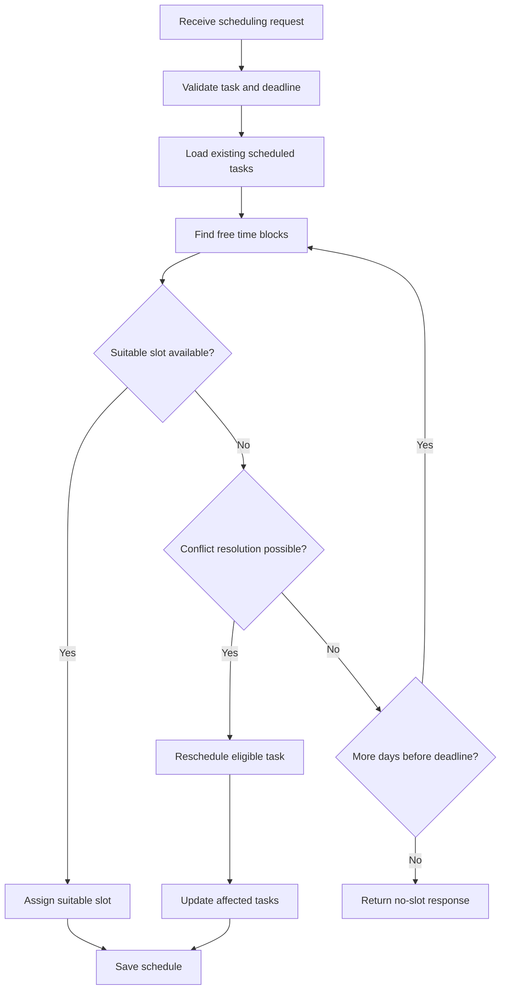

# TaskScheduler

TaskScheduler is a full-stack task and meeting scheduling application that helps users create, manage, and automatically schedule tasks based on duration, priority, deadlines, and available time slots.

The application includes JWT-based authentication, task CRUD operations, automatic scheduling, conflict resolution, calendar-based schedule visualization, and task filtering.

## Live Demo

- **Frontend:** https://task-scheduler-seven-nu.vercel.app/
- **Backend API:** https://task-scheduler-ai60.onrender.com/

## Features

### Task Management

- Create tasks with a title, estimated duration, deadline, and priority.
- Edit existing tasks.
- Delete tasks.
- View all tasks in one place.
- Search tasks by title.
- Filter tasks by status and priority.
- Validate task details before saving.

### Automatic Scheduling

- Automatically finds available time slots for tasks.
- Considers task duration and deadlines.
- Uses task priority during scheduling.
- Prevents overlapping scheduled tasks.
- Attempts to resolve scheduling conflicts.
- Reschedules eligible tasks when required.
- Returns an appropriate error when no valid time slot is available.
- Supports configurable working hours in the scheduling service.

### Calendar and Schedule

- Dedicated schedule page.
- Calendar-based visualization of scheduled tasks.
- View scheduled tasks by date.
- Display task start and end times.
- Schedule preview showing available time blocks.

### Authentication

- User registration and login.
- JWT-based authentication.
- Protected API routes.
- Password hashing using bcryptjs.
- Logout functionality.
- User-specific task access.

### Dashboard

- Total task count.
- Scheduled and unscheduled task counts.
- Task cards displaying task details.
- Quick access to editing, scheduling, and deletion.
- Search and filtering options.

## Tech Stack

### Frontend

- React
- Vite
- React Router
- Axios
- CSS

### Backend

- Node.js
- Express.js
- MongoDB
- Mongoose
- JSON Web Tokens
- bcryptjs
- Helmet
- express-rate-limit

### Testing and Development

- Jest
- Git
- GitHub Actions

### Deployment

- Frontend: Vercel
- Backend: Render
- Database: MongoDB Atlas
- Version Control: Git and GitHub

## System Architecture

```text
                         User
                          |
                          v
                    React Frontend
                     Vite + React
                          |
                          | HTTP / REST API
                          v
                   Express Backend
                          |
              +-----------+-----------+
              |                       |
              v                       v
       Authentication           Task Management
         JWT + bcrypt              Controllers
              |                       |
              +-----------+-----------+
                          |
                          v
                      Scheduler
                 Conflict Resolution
                          |
                          v
                     MongoDB Atlas
```

## Scheduling Algorithm

TaskScheduler assigns tasks to available time slots while considering task duration, deadlines, priority, working hours, and existing scheduled tasks.

### Scheduling Workflow

1. **Validate the request:** Validate the task ID, deadline, and optional working hours.
2. **Retrieve existing tasks:** Fetch the user's scheduled tasks.
3. **Search available days:** Begin with the current day and search through the task's deadline.
4. **Find free time blocks:** Identify intervals that do not overlap with existing scheduled tasks.
5. **Find a suitable slot:** Attempt to assign the task to an available slot.
6. **Resolve conflicts:** If necessary, attempt to reschedule an eligible lower-priority task with a later deadline.
7. **Save the schedule:** Update the newly scheduled task and any affected tasks.
8. **Handle failure:** Return a no-available-slot response when a valid arrangement cannot be found.

### Scheduling Flowchart



### Conflict Resolution

When a suitable slot is unavailable, the scheduler can attempt to move an eligible lower-priority task with a later deadline to another available slot.

If no valid arrangement can be found, the scheduling request fails instead of assigning an invalid slot.

### Working Hours

The default scheduling window is **09:00–21:00**. The scheduling service supports configurable working hours.

Explicit time-zone conversion and configurable breaks are not currently implemented.

## Time Complexity

Let:

- `N` = number of existing scheduled tasks.
- `D` = number of days searched before the deadline.

The following estimates describe the main scheduling operations:

| Operation | Time Complexity |
|---|---|
| Sorting scheduled tasks | `O(N log N)` |
| Finding free time blocks after sorting | `O(N)` |
| Searching across multiple days | Approximately `O(D × N log N)` if tasks are sorted separately each day |
| Database operations | Depends on indexes, query execution, and the number of affected tasks |

These are indicative estimates for the described operations, not a verified worst-case bound for the entire algorithm. Conflict resolution can add further processing, so the exact overall complexity depends on the implementation and execution path.

## API Overview

The backend exposes REST API endpoints for authentication, task management, scheduling, and schedule previews.

### Authentication

| Method | Endpoint | Purpose |
|---|---|---|
| POST | `/api/auth/register` | Register a user |
| POST | `/api/auth/login` | Authenticate a user |

### Tasks

The following endpoints are protected and require authentication.

| Method | Endpoint | Purpose |
|---|---|---|
| GET | `/api/tasks` | Retrieve the logged-in user's tasks |
| POST | `/api/tasks` | Create a task |
| PUT | `/api/tasks/:id` | Update a task |
| DELETE | `/api/tasks/:id` | Delete a task |

### Scheduling

The scheduling endpoints support task scheduling and schedule preview. The exact route paths depend on the route definitions in `server/routes/taskRoutes.js`.

- Schedule a task automatically.
- Preview scheduled tasks and available time blocks for a day.

## Security and Validation

- JWT-based authentication and protected routes.
- Password hashing with bcryptjs.
- User-specific task queries.
- Validation of task titles, durations, deadlines, priorities, statuses, and working hours.
- Helmet security headers.
- Rate limiting for authentication and API endpoints.
- Request body size limits.
- Standardized handling of invalid task IDs and missing tasks.

## Testing and Continuous Integration

The project uses Jest for backend tests and GitHub Actions for continuous integration.

The CI workflow runs when changes are pushed to `main` or a pull request targets `main`.

It performs the following checks:

- Installs frontend dependencies and builds the React application.
- Installs backend dependencies and runs backend tests.

This helps identify frontend build failures and backend test regressions before changes are merged.

## Project Structure

```text
TaskScheduler/
├── client/
│   ├── src/
│   │   ├── components/
│   │   ├── pages/
│   │   ├── services/
│   │   └── App.css
│   ├── package.json
│   └── package-lock.json
├── server/
│   ├── controllers/
│   ├── models/
│   ├── routes/
│   ├── services/
│   │   ├── scheduler.js
│   │   └── scheduler.test.js
│   ├── server.js
│   ├── package.json
│   └── package-lock.json
└── .github/
    └── workflows/
        └── ci.yml
```

## Local Setup

### Prerequisites

- Node.js and npm
- MongoDB Atlas account or a local MongoDB instance
- Git

### 1. Clone the Repository

```bash
git clone https://github.com/shwetashukla0284-del/Task-Scheduler.git
cd Task-Scheduler
```

### 2. Set Up the Backend

```bash
cd server
npm install
```

Create a `.env` file in the `server` directory:

```env
PORT=5000
MONGO_URI=your_mongodb_connection_string
JWT_SECRET=your_secure_secret
JWT_EXPIRES_IN=1d
```

Replace the placeholder values with your own configuration. Never commit `.env` files or production secrets to GitHub.

Start the backend:

```bash
npm start
```

The backend should be available at `http://localhost:5000`.

### 3. Set Up the Frontend

Open a second terminal from the project root:

```bash
cd client
npm install
npm run dev
```

Open the local URL displayed by Vite in your terminal.

### 4. Run Backend Tests

From the `server` directory:

```bash
npm test
```

## Future Improvements

- Explicit time-zone support.
- Configurable breaks and buffers between tasks.
- More comprehensive scheduling and API tests.
- Improved scheduling performance for large task lists.
- Additional scheduling preferences and customization.

## Author

Developed as a full-stack project using React, Node.js, Express, and MongoDB.